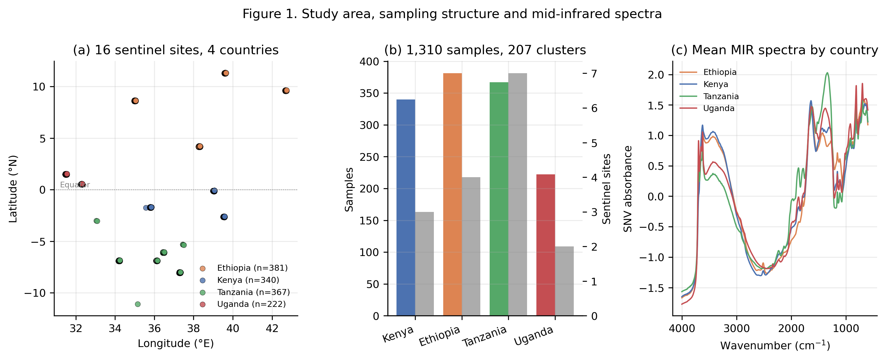
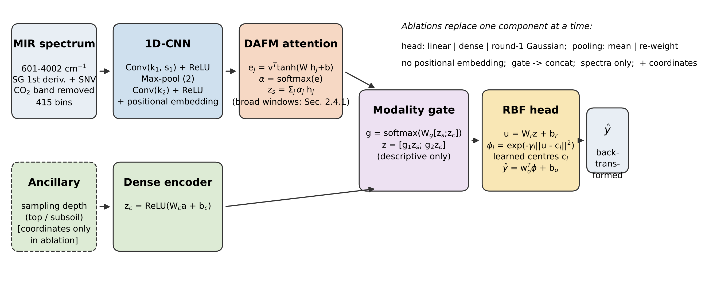
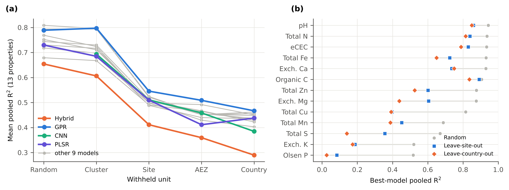
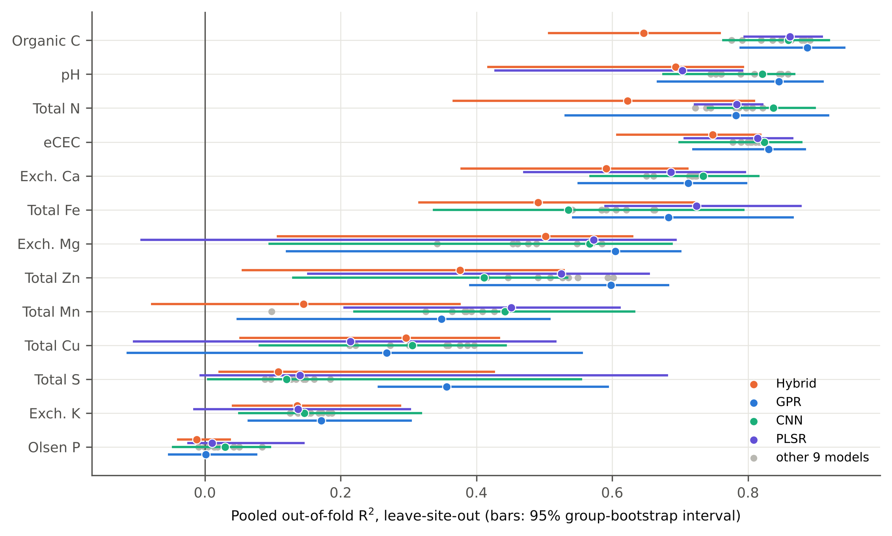
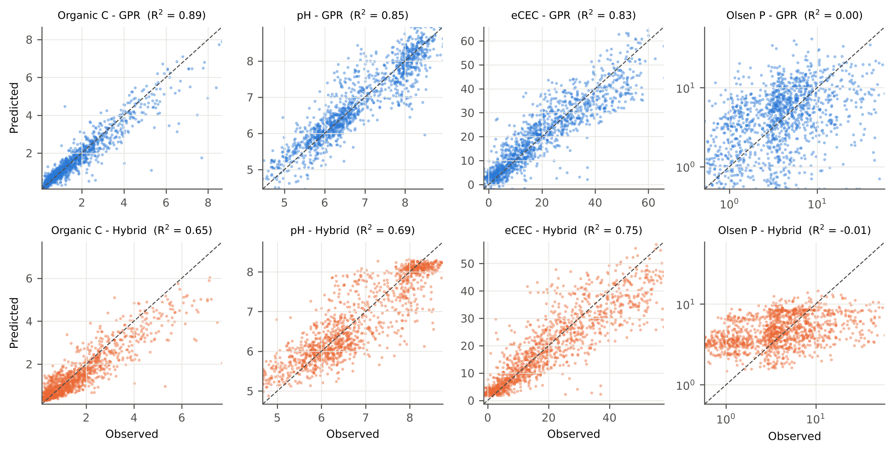
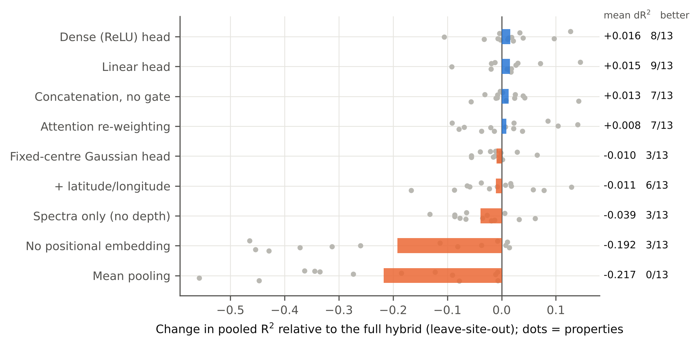
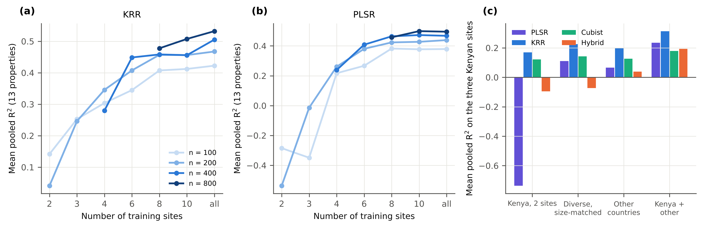
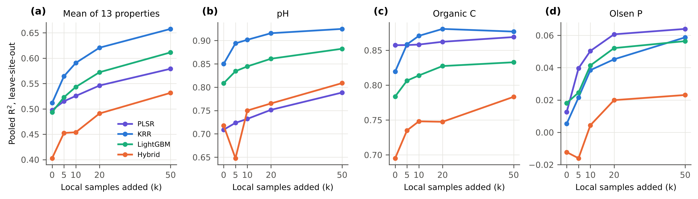
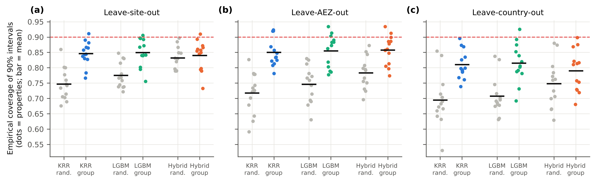
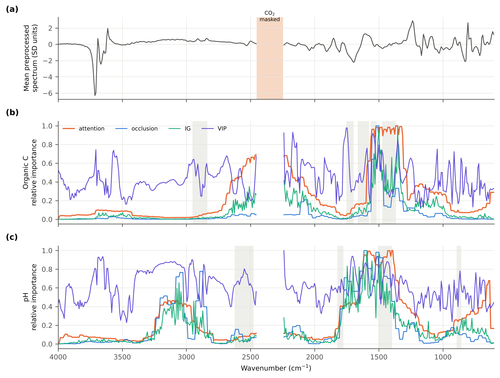

**Comparison of a Hybrid Deep Learning Model with Machine Learning Methods for Mid-Infrared Soil Nutrient Prediction under Spatial Transfer in East Africa**

[Author names, affiliations and the corresponding author's e-mail address have been removed for blind review.]

**Abstract**

Mid-infrared (MIR) spectroscopy can lower the cost of soil testing, but the reported accuracy of spectral models depends strongly on how they are validated. We compared a hybrid deep learning model, an attention-weighted one-dimensional convolutional neural network (CNN) with a radial basis function (RBF) head, with twelve machine learning methods, using 1,310 Africa Soil Information Service samples from 16 sites in Kenya, Ethiopia, Tanzania and Uganda. Thirteen soil properties were modelled under five validation designs that withheld random samples, clusters, sites, agro-ecological zones or countries. Hyperparameters were tuned in nested, group-aware loops, neural models were trained from five random initialisations, and uncertainty was quantified with group bootstrap intervals and paired tests. Skill fell as the withheld unit widened: the median model's mean coefficient of determination (R²) declined from 0.74 under random splitting to 0.51 for a new site and 0.44 for a new country. Gaussian process regression ranked first under every transfer design (leave-site-out mean R² 0.55), although eleven benchmarks were statistically indistinguishable from it. The hybrid ranked last (mean R² 0.41). Ablation showed that positional information and attention pooling were essential, whereas the RBF head and the modality gate gave no benefit, and the RBF head did not limit worst-case errors. Calibration diversity mattered more than size, and adding 50 local samples from the target site raised the mean R² of kernel ridge regression from 0.51 to 0.66. Group-aware conformal intervals reached 85% coverage of a nominal 90% under leave-site-out, compared with 78% with random calibration. Organic carbon, pH and effective cation exchange capacity could be screened against critical levels in unsampled landscapes, but Olsen phosphorus remained unpredictable even with local samples. Diverse calibration libraries and honest validation offer more than added architectural complexity.

**Keywords:** conformal prediction; deep learning; East Africa; machine learning; mid-infrared spectroscopy; soil nutrient prediction; spatial cross-validation; spatial transfer

**1.0 Introduction**

Agriculture underpins the food security and economic stability of most households in sub-Saharan Africa. Despite this central role, smallholder farming systems consistently deliver yields well below their biophysical potential, and soil nutrient depletion is among the most persistent causes. Fertiliser recommendations across much of East Africa are still issued as blanket rates for large administrative units, even though soil fertility varies substantially over distances of a few hundred metres. Closing this gap requires soil information at a spatial density that conventional wet-chemistry analysis cannot supply affordably.

Mid-infrared (MIR) diffuse reflectance spectroscopy offers a credible route past this constraint. A soil spectrum records the vibrational absorbance of mineral and organic constituents, and one measurement taking less than a minute can support the simultaneous estimation of several properties (Janik *et al.*, 1998; Soriano-Disla *et al.*, 2014). The technique has been developed for tropical soils over two decades (Shepherd and Walsh, 2002), and the Africa Soil Information Service (AfSIS) has assembled spectral libraries at continental scale (Hengl *et al.*, 2021; Vågen *et al.*, 2016). Global and open libraries now extend this foundation further (Safanelli *et al.*, 2025; Viscarra Rossel *et al.*, 2016).

Turning a spectral library into reliable agronomic information is a modelling problem. Partial least squares regression (PLSR) remains the operational default. Rule-based Cubist models (Minasny and McBratney, 2008), memory-based learning with local PLS (Ramirez-Lopez *et al.*, 2013) and kernel methods are established alternatives. Convolutional neural networks (CNNs), including multi-output CNNs that predict several properties at once, have been reported to improve on PLSR, particularly with large libraries (Ng *et al.*, 2019; Padarian *et al.*, 2019; Shen and Viscarra Rossel, 2021). More recently, attention-based designs have appeared: Guo *et al.* (2025) transform MIR spectra into two-dimensional images for a Swin Transformer, Shuai *et al.* (2025) couple channel attention with a ConvNeXt backbone for visible–near-infrared data, and Yin *et al.* (2026) use self-attention to weight an ensemble of spectral learners. Using the same AfSIS Phase I archive as the present study, Gruszczyński and Gruszczyński (2022) found that no single algorithm was optimal for all soil variables, and that available phosphorus and several micronutrients were poorly predicted.

Three questions about this literature motivate the present study.

The first concerns **what radial basis function (RBF) components add to a neural network**. RBF networks with learned centres are universal approximators (Park and Sandberg, 1991), and RBF output layers have been combined with deep feature extractors to give distance-aware predictions (van Amersfoort *et al.*, 2020). Kernel methods can also be trained jointly with neural encoders, as in deep kernel learning (Wilson *et al.*, 2016). The question is therefore not whether such a head *can* be trained end to end, which is well established, but whether it *improves* soil spectral prediction relative to a linear or dense head on the same encoder. This can only be answered by ablation, which most architectural studies in soil spectroscopy do not report.

The second concerns **whether attention weights explain a prediction**. Attention weights are often presented as making a network's reasoning transparent. In natural language processing it has been shown that attention distributions need not agree with other importance measures and can be changed without changing the prediction (Jain and Wallace, 2019; Wiegreffe and Pinter, 2019). For spectra, an attention weight has a physical referent (a wavenumber window), but that window can be wide after convolution and pooling. Attention therefore needs to be checked against perturbation-based attribution and known absorbance bands before it is interpreted.

The third concerns **validation design and spatial transfer**, that is, prediction at sites, climatic zones or countries that contributed no samples to calibration. Soil spectral libraries are assembled from clustered sampling campaigns. Random splitting places near-duplicate samples on both sides of the partition, so the resulting accuracy describes interpolation among neighbours rather than prediction at a new location (Ploton *et al.*, 2020; Roberts *et al.*, 2017). Spatial and target-oriented cross-validation (Meyer *et al.*, 2018; Valavi *et al.*, 2019), the area of applicability (Meyer and Pebesma, 2021) and prediction-domain-matched designs (Linnenbrink *et al.*, 2024; Milà *et al.*, 2022) have been proposed in response, while Wadoux *et al.* (2021) caution that spatial cross-validation estimates a specific extrapolation task rather than map accuracy in general. For spectral libraries the corresponding practical questions are how much skill survives transfer to a new landscape or country, whether transfer is limited by the size or by the diversity of the calibration set, and how much a few local samples recover. Spiking (Guerrero *et al.*, 2010; Wetterlind and Stenberg, 2010) and calibration transfer (Gamagedara *et al.*, 2025) are the established responses to that last question.

This study addresses these three questions by comparing a hybrid deep learning model, an attention-weighted CNN–RBF network, with twelve established machine learning methods under spatial transfer in East Africa, using an evaluation designed to test, rather than assume, the contribution of each part of the hybrid. Specifically, we ask:

> 1\. Under nested, group-aware tuning and multiple random initialisations, does the hybrid model, or any of its components (attention, modality gate, RBF head), improve soil nutrient prediction over twelve established machine learning benchmarks?
>
> 2\. How does predictive skill change as the withheld unit widens from a random sample to a sampling cluster, a sentinel site, a climatic agro-ecological zone and a country, and is transfer limited by calibration size or by calibration diversity?
>
> 3\. How much skill do a few local samples recover in a new landscape, and can group-aware conformal prediction provide intervals that remain valid under transfer?
>
> 4\. Do attention weights agree with perturbation-based attribution and with known MIR absorbance regions, and which agronomically interpretable properties can be screened reliably in an unsampled landscape?

We report each outcome as the evidence supports it, including where the results do not favour the hybrid.

**2.0 Materials and Methods**

**2.1 Study area and sampling design**

Samples were drawn from 16 AfSIS Land Degradation Surveillance Framework (LDSF) sentinel sites in four East African countries (Table 1, Figure 1). Each site is a 10 × 10 km block sampled on a randomised, spatially stratified hierarchical design in which clusters are placed within the block and plots within clusters (Vågen *et al.*, 2010). Kenya contributes three sites spanning a pronounced agro-ecological gradient: Morijo in the highland Rift Valley of Narok County, Mbalambala in the arid eastern lowlands of Garissa County, and Marafa in the coastal hinterland of Kilifi County. Ethiopia contributes four sites, Tanzania seven and Uganda two. Three Tanzanian sites (Bukwaya, Kiberashi and Mbinga) contribute only 6 samples between them; they are retained, but they cannot support site-level statistics on their own. Samples were taken at two depths, topsoil (0–20 cm, n = 659) and subsoil (20–50 cm, n = 651), from the same plots, so each topsoil sample has a subsoil partner from the same profile.

For the agro-ecological analysis each site was assigned the Köppen–Geiger climate class (Kottek *et al.*, 2006) of the majority of its sample locations: tropical savanna (Aw; 379 samples, five sites), tropical monsoon (Am; 125, one site), hot semi-arid steppe (BSh; 316, four sites), hot desert (BWh; 119, one site) and temperate highland climates (Cfb, Cwb, Csb and Cwa, combined as C; 371, five sites). Climate class is used here as a transparent, reproducible proxy for agro-ecological zone; it is not a substitute for a national agro-ecological zonation.

Table 1: Composition of the analysis set. Samples are AfSIS Land Degradation Surveillance Framework records with paired MIR spectra and wet chemistry, collected in 2009–2013 at two depths. Köppen–Geiger groups as defined in Section 2.1.

| Country | Samples | Sentinel sites | LDSF clusters | Latitude range (°) | Longitude range (°) | Köppen–Geiger groups |
| --- | ---: | ---: | ---: | ---: | ---: | ---: |
| Kenya | 340 | 3 | 45 | −2.67 to −0.09 | 35.57 to 39.59 | BSh, BWh, C |
| Ethiopia | 381 | 4 | 63 | 4.14 to 11.33 | 34.98 to 42.74 | Aw, C |
| Tanzania | 367 | 7 | 67 | −11.11 to −3.01 | 33.04 to 37.51 | Aw, BSh, C |
| Uganda | 222 | 2 | 32 | 0.49 to 1.53 | 31.46 to 32.34 | Aw, Am |
| **Total** | **1310** | **16** | **207** | – | – | – |

{width=16cm}

Fig. 1. Study area and sampling structure. (a) The 16 sentinel sites, coloured by Köppen–Geiger group, with marker shape showing country and marker size proportional to the number of samples. (b) Samples per site. (c) Mean SNV-corrected MIR spectrum for each Köppen–Geiger group; the atmospheric CO₂ region removed before modelling is shaded.

The 1,310 samples are a stratified sample of landscapes rather than a probability sample of East African cropland, so the data support statements about predictive performance in these landscapes but not population-level prevalence estimates.

**2.2 Data sources and dataset assembly**

Two openly licensed AfSIS deposits were joined on the soil sample number. Vågen *et al.* (2020) provide MIR spectra for about 18,500 AfSIS Phase I samples, measured on a Bruker Tensor 27/HTS-XT FT-IR spectrometer at the World Agroforestry (ICRAF) Soil–Plant Spectral Diagnostics Laboratory in Nairobi. The Kenya, Ethiopia, Tanzania and Uganda files hold 4,654 spectra across 1,749 wavenumbers from 601.7 to 4001.6 cm⁻¹. Vågen *et al.* (2021) provide wet chemistry for 2,002 archived Phase I samples analysed at Rothamsted Research in 2017–2018, of which 1,310 belong to the four study countries. The assembly script verifies that every country file shares an identical wavenumber grid, and the join was complete: all 1,310 chemistry records matched a spectrum.

Thirteen properties were modelled (Table 2): pH in water (1:2.5); organic C and total N by dry combustion; Olsen-extractable P; exchangeable Ca, Mg and K and effective cation exchange capacity (eCEC) by cobalt hexamine extraction with inductively coupled plasma optical emission spectrometry (ICP-OES); and quasi-total S, Fe, Mn, Zn and Cu by aqua regia digestion with ICP-OES. Missing values range from none to four per property. The deposit's variable dictionary transposes the descriptions of the total N and total C columns; the column names are correct, as the observed medians confirm, and the names were used.

Table 2: Soil properties modelled. Skew is computed on all samples; the log(1 + y) decision was made within each training fold. The last column marks properties whose analytical method measures a fraction for which agronomic critical levels are commonly used (Section 3.9).

| Property | Source column | Method | Unit | n | Median | Skew | Transform | Interpretive thresholds used? |
| --- | ---: | ---: | ---: | ---: | ---: | ---: | ---: | ---: |
| pH | pH (water, 1:2.5) | Potentiometric | – | 1300 | 6.6 | 0.06 | none | Yes |
| Organic C | Percent_Org_C | Dry combustion | % | 1307 | 1.18 | 3.35 | log(1+y) | Yes |
| Total N | Percent_N | Dry combustion | % | 1302 | 0.09 | 3.23 | log(1+y) | No |
| Olsen P | Olsen.P | NaHCO₃ extraction | mg kg⁻¹ | 1310 | 2.93 | 10.00 | log(1+y) | Yes |
| Exch. Ca | Caex | Cobalt hexamine | cmolc kg⁻¹ | 1310 | 10.7 | 0.99 | none | Yes |
| Exch. Mg | Mgex | Cobalt hexamine | cmolc kg⁻¹ | 1310 | 2.94 | 1.80 | none | Yes |
| Exch. K | Kex | Cobalt hexamine | cmolc kg⁻¹ | 1310 | 0.453 | 5.39 | log(1+y) | Yes |
| eCEC | eCEC | Sum of cations | cmolc kg⁻¹ | 1310 | 16.6 | 0.73 | none | Yes |
| Total S | S | Aqua regia | mg kg⁻¹ | 1310 | 124 | 13.86 | log(1+y) | No |
| Total Fe | Fe | Aqua regia | mg kg⁻¹ | 1310 | 2.85e+04 | 2.52 | log(1+y) | No |
| Total Mn | Mn | Aqua regia | mg kg⁻¹ | 1310 | 786 | 2.95 | log(1+y) | No |
| Total Zn | Zn | Aqua regia | mg kg⁻¹ | 1310 | 32.6 | 1.55 | none | No |
| Total Cu | Cu | Aqua regia | mg kg⁻¹ | 1310 | 12.7 | 2.64 | log(1+y) | No |

Two features of the data matter for interpretation. First, the spectra were acquired on samples collected in 2009–2013, while the reference chemistry was determined on the archived material in 2017–2018. Storage of air-dried soil can change extractable P, exchangeable K and mineral N (Bartlett and James, 1980), so part of the error for these properties may reflect a mismatch between the sample that was scanned and the sample that was analysed, rather than a spectral limitation. Second, Olsen P is strongly skewed (median 2.9 mg/kg; 32% of samples below 2 mg/kg), so many values lie close to the range in which analytical precision is poorest. The deposit does not report replicate precision, so the attainable R² for Olsen P cannot be estimated directly; Section 3.9 gives a sensitivity analysis.

**2.3 Spectral preprocessing**

Spectra were smoothed and differentiated with a Savitzky–Golay filter (window 11 points, second-order polynomial, first derivative), corrected for multiplicative scatter with the standard normal variate (SNV), and averaged in bins of four adjacent wavenumbers. The atmospheric CO₂ region (2450–2250 cm⁻¹) was removed before binning, leaving 415 bins of about 7.8 cm⁻¹. These operations act on each spectrum separately and share no statistic between samples. The only data-dependent step, per-bin standardisation, was fitted on training rows only. Target variables whose training-fold skewness exceeded 2.0 were modelled on the log(1 + y) scale; predictions were back-transformed before any metric was computed, so all errors are in the original units. The preprocessing choices were tested against five alternatives (no CO₂ mask; SNV applied before the derivative; SNV only; a second derivative; bins of eight) in a sensitivity analysis with PLSR and kernel ridge regression under leave-site-out (Table S4).

**2.4 Hybrid deep learning model: attention-weighted CNN–DAFM–RBF network**

The hybrid model (Figure 2; referred to below as the hybrid) has a spectral branch, an ancillary branch, a modality gate and an RBF regression head, trained end to end.

***2.4.1 Spectral branch.*** Two one-dimensional convolutional layers with ReLU activation and an intervening max-pooling layer produce a feature map **H** ∈ ℝ^p×C^, where p indexes spectral positions and C the learned channels:

EQ:: *h*~j,l~ = σ(Σ~k~ *w*~k,l~ *x*~j+k−1~ + *b*~l~)   (1)

A learned positional embedding **e**ⱼ ∈ ℝ^C^ is added to each position (**h**ⱼ ← **h**ⱼ + **e**ⱼ). Without it, any pooling over positions is permutation-invariant and cannot tell where in the spectrum a feature occurred; its contribution is tested as an ablation. With the selected configuration, each position integrates a receptive field of 37 input bins (about 286 cm⁻¹), and adjacent positions are 31 cm⁻¹ apart. Attention weights therefore refer to broad spectral windows, not to individual wavenumbers.

{width=16cm}

Fig. 2. The hybrid attention-weighted CNN–DAFM–RBF architecture. The spectral branch applies two convolutional layers with a learned positional embedding; the Dynamic Attention Fusion Module pools positions with additive attention; a softmax gate combines the spectral context with the encoded ancillary input (depth); and an RBF layer with learned centres produces the prediction, which is back-transformed for log-modelled properties. The components replaced in the ablation study are listed at upper right.

***2.4.2 Dynamic Attention Fusion Module (DAFM).*** Additive attention over positions forms a spectral context vector:

EQ:: *e*~j~ = **v**^⊤^ tanh(**W** **h**~j~ + **b**),  α~j~ = exp(*e*~j~) ⁄ Σ~k~ exp(*e*~k~),  **z**~s~ = Σ~j~ α~j~ **h**~j~   (2)

***2.4.3 Ancillary branch and modality gate.*** A dense layer encodes the ancillary input, sampling depth, into **z**~c~. A softmax gate weights the two branches for each sample, **g** = softmax(**W**~g~[**z**~s~; **z**~c~] + **b**~g~), and the fused vector is **z** = [g₁**z**~s~; g₂**z**~c~]. Because **g** multiplies vectors of different dimension and scale, and the encoders can rescale to compensate, g₁ is not an identifiable share of the prediction. It is reported only descriptively; modality contributions are estimated instead by ablation and permutation (Section 2.9).

***2.4.4 RBF head with learned centres.*** The fused vector is projected to a low-dimensional space, **u** = **W**~r~**z** + **b**~r~, and compared with R learned centres **c**ᵢ:

EQ:: φ~i~ = exp(−γ~i~ ‖**u** − **c**~i~‖²),  *ŷ* = **w**~o~^⊤^ **φ** + *b*~o~   (3)

with γᵢ = exp(log γᵢ) > 0. This is a standard RBF network layer with learned centres (Park and Sandberg, 1991) placed on a neural encoder, in the spirit of van Amersfoort *et al.* (2020). It is not a support vector regressor or a kernel machine. A simpler variant, a dense layer followed by a Gaussian activation centred at zero (φᵢ = exp(−γᵢpᵢ²)), is tested as an ablation. Because 0 < φᵢ ≤ 1, the output satisfies |ŷ − b~o~| ≤ ‖**w**~o~‖₁. This bound is a property of the construction, not evidence of robustness: ‖**w**~o~‖₁ is learned and can be large, and for log-modelled targets a bounded output on the log scale can still be large after back-transformation. Whether the bound limits failures in practice is therefore tested directly (Section 3.4), and the learned ‖**w**~o~‖₁ is reported.

**2.5 Machine learning benchmark models**

Twelve benchmarks were run: PLSR, ridge regression, support vector regression (SVR) with an RBF kernel, kernel ridge regression (KRR) with an RBF kernel, Gaussian process regression (GPR) with an RBF plus white-noise kernel and marginal-likelihood hyperparameters, and random forest, all from scikit-learn (Pedregosa *et al.*, 2011); gradient boosting with LightGBM; Cubist (regression rules with committees and optional instance-based correction, on the first 30 principal components; Minasny and McBratney, 2008); memory-based learning (MBL), in which each prediction is a weighted average of local PLS models fitted to the k nearest training spectra in whitened principal-component space (Ramirez-Lopez *et al.*, 2013); a multilayer perceptron (MLP); a plain 1D-CNN with flattened convolutional features and a dense head (Padarian *et al.*, 2019); and a multi-output version of that CNN predicting all 13 properties jointly with a masked loss (Ng *et al.*, 2019). The neural networks were implemented in PyTorch. **Every model received the same inputs**: the preprocessed spectrum and the depth flag. Coordinates were excluded from all main analyses because latitude and longitude are a known hazard under spatial extrapolation (Meyer and Pebesma, 2021); their effect is tested in an ablation. Because the ancillary input is limited to depth, we refer to the combination as spectral–ancillary fusion.

All models except MBL were fitted with maintained, widely used libraries, so that the benchmarks reflect standard practice and can be reproduced exactly; MBL, which has no maintained Python package, was assembled from scikit-learn components. Early stopping and hyperparameter selection used only training-fold data (Section 2.6), and every number reported in this paper is regenerated from stored per-fit records by a single script (Section 2.10).

**2.6 Tuning, training and random seeds**

Hyperparameters were selected inside each outer training fold (nested selection), using a group-disjoint inner split, so the outer test fold was never used for any decision. The inner unit was the same as the outer unit for the cluster and site designs, and the sentinel site for the country and agro-ecological designs, in which only three or four outer groups remain in training. Search spaces were sized to each model's hyperparameters (Table S2): one-dimensional grids for PLSR (7 values) and ridge (11), two-dimensional grids for SVR (9), KRR (9), Cubist (4) and LightGBM (2 leaf settings, with the number of trees set by early stopping), MBL (3 neighbourhood sizes), and three architectures for each neural model. For cheap models the inner score was the mean over three group-disjoint inner folds; for expensive models a single inner split holding out about 20% of the training samples by group was used. Neural networks were trained with Adam (Kingma and Ba, 2015), learning rates of 10⁻³ to 3 × 10⁻³ and weight decay, with early stopping on the same group-disjoint inner split (patience 10 epochs, maximum 80). Each neural model was trained from **five random initialisations** in every fold. Neural results are reported as the mean over seeds, with the seed standard deviation, and every bootstrap draw averages over seeds, so seed variability is carried into the confidence intervals.

**2.7 Validation designs**

Five designs were compared, ordered by how far the test samples lie from the training data (Table S1 lists the composition of each fold):

> \- **Random** (5 folds): samples assigned at random, ignoring grouping. This is included only to quantify the optimism of random splitting.
>
> \- **Leave-cluster-out** (5 folds): the 207 LDSF clusters assigned to folds, so no cluster contributes to both training and test. Because topsoil and subsoil samples from one profile belong to the same cluster, the grouping also keeps profile pairs together.
>
> \- **Leave-site-out** (8 folds): the 16 sentinel sites assigned to eight folds of one to three sites each, balanced by sample count.
>
> \- **Leave-AEZ-out** (5 folds): each Köppen–Geiger group held out in turn.
>
> \- **Leave-country-out** (4 folds): each country held out in turn.

In every design each fold serves once as the test fold, so every sample, and every country, is predicted from models that never saw it.

**2.8 Evaluation metrics and statistical tests**

Within each design every sample is predicted exactly once, so metrics were computed on the pooled out-of-fold predictions. This avoids the instability of R² computed on small folds with little variance. We report R², root mean square error (RMSE), RMSE divided by the training-set standard deviation, the ratio of performance to deviation (RPD = SD/RMSE), the ratio of performance to interquartile distance (RPIQ; Bellon-Maurel *et al.*, 2010), Lin's concordance correlation coefficient (CCC; Lin, 1989), and the mean absolute error skill relative to predicting the training-fold mean (MAE skill = 1 − MAE/MAE_mean). R² on the log scale is also given for skewed properties. Back-transformed predictions were limited to the range of the target in the training fold, identically for every model; Section 3.4 reports what happens without this safeguard. The range of per-fold R² is reported only as a description of dispersion. Confidence intervals come from a group bootstrap (2,000 draws) that resamples the outer spatial units (clusters for the random and cluster designs, sites otherwise) with replacement. Models were compared with paired group-bootstrap tests on the difference in pooled R², using the same draws for both models, and across properties with the Friedman test and the Nemenyi critical difference (Demšar, 2006). No metric is selected post hoc as a maximum over models; where a best model is named, it is the model with the best mean rank, and its paired comparisons with the other models are reported.

**2.9 Additional experiments**

*Ablation.* Under leave-site-out, each component of the hybrid was replaced in turn while everything else, including the selected configuration, was held fixed: (a) linear head; (b) dense ReLU head; (c) a fixed-centre Gaussian-activation head; (d) mean pooling instead of attention; (e) attention used to re-weight positions, followed by flattening, instead of attention pooling; (f) no positional embedding; (g) concatenation instead of the gate; (h) spectra only, without the ancillary branch; and (i) coordinates added to the ancillary input (also tested for LightGBM). Ablations used three seeds, except the linear head, which used five.

*Boundedness.* The hybrid was compared with the otherwise identical network with a linear head under the site, agro-ecological and country designs, on both the original and the log scale. The comparison used worst-case and lower-decile per-property R², and ‖**w**~o~‖₁ was reported.

*Calibration breadth.* (i) Like-for-like: each Kenyan site was predicted from the other two Kenyan sites (K2), from those sites plus all non-Kenyan samples (K2 + EA), from non-Kenyan samples only (EA), and from K2 + EA subsampled to the size of K2 (K2 + EA, size-matched; five draws). The test population is identical in every condition, and the size-matched condition separates diversity from sample size. Inner tuning splits were by site, except in the two-site Kenyan condition, where clusters were used. (ii) Learning curves: within each leave-site-out fold, training sets of n = 100, 200, 400 and 800 samples were drawn from m = 2, 3, 4, 6, 8, 10 or all training sites (three draws per cell), with the test fold fixed.

*Local spiking.* For each leave-site-out fold, k = 0, 5, 10, 20 or 50 samples from the withheld sites were added to the training set. Spike sets were nested, and every k was scored on the same test samples: the withheld samples, excluding the 50 candidates and any sample from the same profile. Three draws were made for PLSR, KRR and LightGBM and one for the hybrid.

*Conformal prediction.* Split-conformal intervals (Angelopoulos and Bates, 2023) at a nominal 90% level were calibrated on a set held out of each training fold and not used for fitting. Two calibration sets were compared: whole sites (group-aware) and a random 20% of training samples. Residuals were computed on the fitting scale and the intervals back-transformed.

*Interpretability.* For each leave-site-out hybrid model, the attention profile (spread over each position's receptive field) was compared with occlusion importance (an eight-bin window set to the training mean), integrated gradients (Sundararajan *et al.*, 2017) and PLSR variable importance in projection (VIP). Agreement was measured with Spearman correlation. The share of importance falling inside literature absorbance windows (Janik *et al.*, 1998; Nguyen *et al.*, 1991; Parikh *et al.*, 2014) was compared with 2,000 random circular shifts of the same profile, which preserve its autocorrelation. Modality contribution was estimated by permuting the ancillary input in the test fold and by the spectra-only ablation, not from the gate.

*Agronomic screening.* For properties with accepted interpretive classes for the extraction used (pH, organic C, Olsen P, exchangeable Ca, Mg and K, eCEC), out-of-fold leave-site-out predictions were used to classify samples against indicative critical levels (Landon, 1991). Sensitivity, specificity and balanced accuracy were computed. No deficiency diagnosis was attempted for quasi-total elements or total N, which do not measure plant-available fractions (Lindsay and Norvell, 1978).

**2.10 Implementation and reproducibility**

All code is in Python 3 (NumPy, pandas, scikit-learn 1.9.1, LightGBM 4.7.0, PyTorch, cubist). Fold assignments are deterministic (seed 20260804); neural seeds are 11, 22, 33, 44 and 55. In total 84,900 model fits were run. Each fit writes a record with the selected configuration, test indices and predictions, and every table, figure and number in this manuscript is regenerated from those records by a single script.

**3.0 Results and Discussion**

**3.1 Effect of validation design**

The validation design changed the apparent skill of every model more than the choice of model did (Table 3, Figure 3). Averaged over the thirteen properties, the median model's pooled R² was 0.744 under random splitting and 0.711 under leave-cluster-out. It fell to 0.507 when whole sites were withheld, 0.453 for a withheld climatic zone and 0.436 for a withheld country. Results for every model, property and design are given in Table S3. Relative to random splitting, these are losses of 32%, 39% and 41% of the apparent skill. Random splitting and leave-cluster-out gave similar values because clusters within a site share soils and land use, so a model tested on a new cluster has usually seen its neighbours. Accuracy figures obtained from random or within-site splits therefore describe interpolation within surveyed landscapes and should not be quoted as the expected accuracy in a new area.

Table 3: Mean pooled out-of-fold R² across the thirteen properties for each model and validation design, and the mean Friedman rank under leave-site-out (1 = best). The highest value in each design is in bold. The random design was run for all models except the two CNNs.

| Model | Random | Leave-cluster-out | Leave-site-out | Leave-AEZ-out | Leave-country-out | Mean rank (site) |
| --- | ---: | ---: | ---: | ---: | ---: | ---: |
| PLSR | 0.730 | 0.685 | 0.510 | 0.411 | 0.438 | 6.92 |
| Ridge | 0.744 | 0.730 | 0.512 | 0.451 | 0.455 | 6.69 |
| SVR | **0.808** | 0.796 | 0.524 | 0.451 | 0.462 | 6.00 |
| KRR | 0.793 | 0.794 | 0.521 | 0.453 | 0.448 | 6.08 |
| GPR | 0.789 | **0.797** | **0.545** | **0.509** | **0.467** | 4.92 |
| Cubist | 0.718 | 0.697 | 0.488 | 0.440 | 0.435 | 8.00 |
| MBL | 0.769 | 0.724 | 0.498 | 0.491 | 0.451 | 5.46 |
| RF | 0.679 | 0.667 | 0.490 | 0.464 | 0.429 | 7.62 |
| LightGBM | 0.730 | 0.716 | 0.505 | 0.467 | 0.422 | 7.23 |
| MLP | 0.752 | 0.711 | 0.507 | 0.456 | 0.436 | 6.38 |
| CNN | – | 0.693 | 0.510 | 0.458 | 0.385 | 6.08 |
| MO-CNN | – | 0.683 | 0.499 | 0.429 | 0.403 | 7.69 |
| Hybrid | 0.654 | 0.606 | 0.411 | 0.359 | 0.290 | 11.92 |

{width=16cm}

Fig. 3. Effect of validation design. (a) Mean pooled R² across the thirteen properties for each model as the withheld unit widens; four models are highlighted and the remaining nine are shown in grey. (b) Highest R² of any model for each property under random splitting, leave-site-out and leave-country-out.

The decline was strongly property-dependent (Figure 3b). Organic C, pH, total N and eCEC lost little skill under transfer: their best leave-country-out R² values were 0.84, 0.85, 0.82 and 0.79. Exchangeable K, total S and Olsen P lost most. Olsen P is the clearest case: R² was 0.52 under random splitting but at most 0.08 under leave-site-out and 0.03 under leave-country-out. Most of the apparent skill for Olsen P under random splitting therefore probably comes from recognising the site, not from a spectral signal for available P.

**3.2 Model comparison under spatial transfer**

Table 4 and Figure 4 give the leave-site-out results by property. Gaussian process regression (GPR) had the best mean rank under leave-site-out (4.92), leave-AEZ-out (3.62) and leave-country-out (5.08), and the highest mean R² in all three (0.545, 0.509 and 0.467). The differences among models were, however, small. Excluding the hybrid, the spread of mean R² between the best and worst model was 0.057 under leave-site-out and 0.082 under leave-country-out. The Friedman test detected differences among the thirteen models (χ² = 30.9, p = 0.002), but the Nemenyi critical difference (5.06 rank units) placed 11 of the other twelve models within reach of GPR; only the hybrid fell outside it. On paired group-bootstrap tests GPR was significantly better than another model in 33 of the 156 model–property comparisons involving it. The ranking among well-tuned conventional learners is therefore weak, and no single algorithm should be recommended on these data alone. This agrees with Gruszczyński and Gruszczyński (2022), who found no universally best algorithm on the same AfSIS archive.

Table 4: Leave-site-out performance by property for GPR (the model with the best mean rank), with PLSR, the plain CNN and the hybrid for comparison. R² and its 95% group-bootstrap interval are computed on pooled out-of-fold predictions; RMSE is in the units of Table 2; RPD, RPIQ and CCC are for GPR (all metrics for all models, including MAE skill, are in the released results file). *The highest R² of the thirteen models is shown only descriptively: selecting it after testing is optimistic.

| Property | GPR R² (95% CI) | GPR RMSE | RPD | RPIQ | CCC | PLSR R² | CNN R² | Hybrid R² (95% CI) | Highest of 13 models* |
| --- | ---: | ---: | ---: | ---: | ---: | ---: | ---: | ---: | ---: |
| Organic C | 0.887 (0.79, 0.94) | 0.584 | 2.98 | 2.88 | 0.94 | 0.862 | 0.859 | 0.646 (0.51, 0.76) | 0.891 (Ridge) |
| pH | 0.845 (0.67, 0.91) | 0.432 | 2.54 | 4.54 | 0.92 | 0.703 | 0.821 | 0.694 (0.42, 0.79) | 0.859 (SVR) |
| eCEC | 0.830 (0.72, 0.88) | 6.641 | 2.43 | 3.67 | 0.91 | 0.814 | 0.824 | 0.748 (0.61, 0.82) | 0.830 (GPR) |
| Total N | 0.782 (0.53, 0.92) | 0.059 | 2.14 | 2.02 | 0.87 | 0.783 | 0.837 | 0.622 (0.37, 0.81) | 0.839 (MLP) |
| Exch. Ca | 0.712 (0.55, 0.80) | 6.031 | 1.86 | 2.71 | 0.84 | 0.686 | 0.734 | 0.591 (0.38, 0.71) | 0.736 (MBL) |
| Total Fe | 0.683 (0.54, 0.87) | 19279 | 1.78 | 1.68 | 0.81 | 0.724 | 0.536 | 0.491 (0.32, 0.72) | 0.724 (PLSR) |
| Exch. Mg | 0.605 (0.12, 0.70) | 2.342 | 1.59 | 1.74 | 0.77 | 0.573 | 0.567 | 0.502 (0.11, 0.63) | 0.605 (GPR) |
| Total Zn | 0.598 (0.39, 0.68) | 22 | 1.58 | 2.06 | 0.73 | 0.525 | 0.411 | 0.376 (0.06, 0.53) | 0.602 (RF) |
| Total S | 0.356 (0.26, 0.59) | 283 | 1.25 | 0.51 | 0.44 | 0.140 | 0.120 | 0.108 (0.02, 0.43) | 0.356 (GPR) |
| Total Mn | 0.348 (0.05, 0.51) | 691 | 1.24 | 1.37 | 0.59 | 0.452 | 0.442 | 0.145 (−0.08, 0.38) | 0.452 (PLSR) |
| Total Cu | 0.268 (−0.11, 0.56) | 11 | 1.17 | 1.36 | 0.59 | 0.214 | 0.306 | 0.296 (0.05, 0.43) | 0.397 (RF) |
| Exch. K | 0.172 (0.06, 0.30) | 1.016 | 1.10 | 0.67 | 0.35 | 0.137 | 0.147 | 0.136 (0.04, 0.29) | 0.187 (KRR) |
| Olsen P | 0.002 (−0.05, 0.08) | 27 | 1.00 | 0.18 | 0.07 | 0.010 | 0.030 | −0.012 (−0.04, 0.04) | 0.084 (MBL) |

{width=16cm}

Fig. 4. Leave-site-out R² by property for all thirteen models. GPR, the plain CNN, PLSR and the hybrid are highlighted, with 95% group-bootstrap intervals; the other nine models are shown as grey points.

With GPR, 4 properties reached an RPD of at least 2 in unsampled landscapes: organic C (R² = 0.89), pH (0.85), eCEC (0.83) and total N (0.78). Exchangeable Ca, total Fe, exchangeable Mg and total Zn were moderately predictable, and total Mn, Cu and S, exchangeable K and Olsen P were poorly predictable (Figure 5). PLSR, the operational default in soil spectroscopy, remained competitive: it ranked 6th of 13 by mean R² under leave-site-out (0.510) and was the best model for total Fe and total Mn. There is therefore no case, on these data, for abandoning PLSR in favour of more complex learners.

{width=16cm}

Fig. 5. Out-of-fold observed and predicted values under leave-site-out for GPR (top) and the hybrid (bottom). The dashed line is the 1:1 line. Olsen P is shown on logarithmic axes.

The hybrid ranked last in every design (mean rank 11.9 of 13 under leave-site-out), with mean R² of 0.411, 0.359 and 0.290 under the three transfer designs. It was significantly worse than another model in 70 of 156 paired comparisons under leave-site-out and significantly better in none. It was also the least stable neural model across random initialisations (mean seed standard deviation of R² 0.041, against 0.028 for the CNN and 0.022 for the MLP). The plain CNN with flattened features performed like the other benchmarks, and the multi-output CNN gave no advantage over separate models. Deep architectures were therefore not inherently disadvantaged at this sample size; the hybrid's particular design was. The next two sections show why.

**3.3 Ablation of the hybrid architecture**

Table 5 and Figure 6 report the effect of replacing each component in turn. Two components were essential. Replacing attention pooling with mean pooling reduced mean R² by 0.217 and harmed every property. Removing the positional embedding reduced it by 0.192, with significant losses for 8 properties. Both results have the same cause. Without positional information, pooling over spectral positions discards where in the spectrum a feature occurred, and that location is what distinguishes, for example, a carbonate band from a clay hydroxyl band. Attention pooling with a positional embedding can recover some of this information by weighting positions; without the embedding, attention pooling loses most of its value. Any attention-pooled spectral model therefore needs explicit positional information.

Table 5: Ablation of the hybrid under leave-site-out. Each row replaces one component of the full model, keeping the selected configuration fixed (three seeds; five for the linear head). ΔR² is the change in pooled R² relative to the full model, averaged over the thirteen properties; significant gains or losses are properties whose paired 95% group-bootstrap interval for ΔR² excludes zero.

| Component | Change | Mean R² | Mean ΔR² | Properties improved | Significant gains | Significant losses |
| --- | ---: | ---: | ---: | ---: | ---: | ---: |
| – | Full hybrid (reference) | 0.411 | – | – | – | – |
| Head | RBF head → linear output | 0.427 | 0.015 | 9/13 | 2 | 0 |
| Head | RBF head → dense ReLU layer | 0.427 | 0.016 | 8/13 | 2 | 1 |
| Head | RBF head → fixed-centre Gaussian activation | 0.401 | −0.010 | 3/13 | 0 | 0 |
| Pooling | Attention pooling → mean pooling | 0.194 | −0.217 | 0/13 | 0 | 9 |
| Pooling | Attention pooling → attention re-weighting + flatten | 0.420 | 0.008 | 7/13 | 2 | 1 |
| Pooling | Positional embedding removed | 0.219 | −0.192 | 3/13 | 0 | 8 |
| Fusion | Gate → plain concatenation | 0.424 | 0.013 | 7/13 | 1 | 0 |
| Fusion | Ancillary branch removed (spectra only) | 0.372 | −0.039 | 3/13 | 1 | 5 |
| Inputs | Latitude and longitude added | 0.400 | −0.011 | 6/13 | 3 | 3 |

{width=16cm}

Fig. 6. Ablation of the hybrid under leave-site-out. Bars give the mean change in pooled R² across the thirteen properties when one component is replaced; grey points are individual properties.

None of the components that motivated the hybrid design improved prediction. Replacing the RBF head with a linear output layer raised mean R² by 0.015 (better for 9 of 13 properties), and a dense ReLU head gave +0.016. A fixed-centre Gaussian-activation head was slightly worse than the learned-centre RBF head (−0.010), with no significant difference for any property. Replacing the modality gate with plain concatenation changed R² by +0.013. Using attention to re-weight positions before flattening, rather than to pool them, changed R² by +0.008, so the remaining gap to the plain CNN is not explained by any single module. Removing the ancillary input lowered R² by 0.039, with significant losses for 5 properties, so sampling depth carries real information. Adding latitude and longitude did not help on average (−0.011): it helped three properties and harmed three, as expected when coordinates are used to extrapolate into unsampled space (Meyer and Pebesma, 2021). Adding coordinates to LightGBM likewise gave no average benefit (mean ΔR² below 0.001 in magnitude).

In short, the hybrid works only to the extent that it behaves like a CNN with position-aware pooling, and its distinctive components (the RBF head and the gate) add parameters and seed instability without adding skill. The architecture therefore does not achieve its design objective. What the experiment does show is narrower: a differentiable RBF head *can* be trained jointly with a convolutional encoder. That is already well established (van Amersfoort *et al.*, 2020; Wilson *et al.*, 2016), and it is not, on this evidence, a reason to use one.

**3.4 Does a bounded head limit worst-case failure?**

Because every RBF unit outputs a value between 0 and 1, the hybrid's prediction cannot move further than ‖**w**~o~‖₁ from its bias (Section 2.4.4). It is tempting to conclude that such a head protects against catastrophic extrapolation. We tested this directly against the otherwise identical network with a linear head (Table 6). The learned ‖**w**~o~‖₁ had a median of 5.49 (5th–95th percentile 3.23–7.96; maximum 10.7) on the standardised target scale. The bound therefore allows predictions several standard deviations from the training mean, which is wider than the range of most targets. In practice, the worst single-property R² of the two heads was similar: under leave-site-out, −0.012 for the RBF head and 0.001 for the linear head; under leave-country-out, −0.133 and −0.165. The linear head was no worse on the log scale, and the comparison did not depend on clipping to the training range. A bounded output layer therefore gave no practical protection against poor transfer.

Table 6: Worst-case and lower-decile per-property R² for the hybrid with its RBF head and with a linear head, under three transfer designs, on the original scale (raw back-transformation and clipped to the training range) and on the log(1 + y) scale (worst log-R²).

| Design | Back-transform | Worst R² RBF | Worst R² linear | 10th pct RBF | 10th pct linear | Worst log-R² RBF | Worst log-R² linear | Mean R² RBF | Mean R² linear |
| --- | ---: | ---: | ---: | ---: | ---: | ---: | ---: | ---: | ---: |
| Leave-site-out | raw | −0.012 | 0.001 | 0.114 | 0.100 | 0.093 | 0.099 | 0.411 | 0.423 |
| Leave-site-out | clipped | −0.012 | 0.001 | 0.114 | 0.102 | 0.093 | 0.099 | 0.411 | 0.427 |
| Leave-AEZ-out | raw | −0.022 | −0.009 | 0.108 | 0.070 | 0.132 | 0.139 | 0.359 | 0.357 |
| Leave-AEZ-out | clipped | −0.022 | −0.009 | 0.108 | 0.070 | 0.132 | 0.140 | 0.359 | 0.361 |
| Leave-country-out | raw | −0.133 | −0.165 | −0.006 | 0.008 | −0.067 | −0.003 | 0.290 | 0.286 |
| Leave-country-out | clipped | −0.133 | −0.161 | −0.006 | 0.008 | −0.067 | 0.037 | 0.290 | 0.293 |

Extreme failures had a different cause: the back-transformation of log-modelled properties. Without any range safeguard, 5 model–property–design combinations had R² below −1, all for total S (skewness 13.9), and they involved GPR, kernel ridge regression, the MLP, ridge regression and SVR. The worst was R² = −93.4 (ridge regression, total S, random design). In each case a few predictions that were moderately high on the log scale became extreme after exponentiation. Limiting back-transformed predictions to the range of the target in the training fold, a safeguard any deployed system would apply, removed all of these failures. It changed no other result materially, so it was applied identically to every model throughout this paper (Section 2.8). A practical lesson is that skewed soil properties should be evaluated on both scales, and a bounded output layer should not be mistaken for a bounded prediction.

**3.5 Calibration size versus calibration diversity**

A simple comparison of a national calibration with a regional one changes sample size, number of sites and test population at once. Two experiments were designed to separate these factors. In the like-for-like test, the test population was always the three Kenyan sites (Table 7, Figure 7c). Averaged over models, calibrating on the other two Kenyan sites gave a mean pooled R² of −0.136. A calibration of exactly the same size drawn from about 13 sites across the region gave 0.101, and was better for 9 of 13 properties. At constant size, then, diversity helped. Using all non-Kenyan samples without any Kenyan sample gave 0.108, and adding the two other Kenyan sites to them gave the best result, 0.230 (better than non-Kenyan data alone for 11 of 13 properties). Kenyan samples are therefore valuable, but only within a broad library.

Table 7: Like-for-like test of calibration breadth. The test set is always the three Kenyan sentinel sites (leave-one-Kenyan-site-out, pooled). Values are mean pooled R² across the thirteen properties. Classical models were tuned inside each training set; the hybrid used the base configuration of Table S2 with one initialisation, so its values are indicative.

| Calibration set | Training n | Training sites | PLSR | KRR | Cubist | Hybrid | Mean |
| --- | ---: | ---: | ---: | ---: | ---: | ---: | ---: |
| Two Kenyan sites (K2) | 226 | 2.0 | −0.737 | 0.169 | 0.121 | −0.095 | −0.136 |
| K2 + EA, size-matched to K2 | 226 | 13.2 | 0.110 | 0.225 | 0.143 | −0.074 | 0.101 |
| Other countries only (EA) | 969 | 12.9 | 0.065 | 0.200 | 0.127 | 0.039 | 0.108 |
| K2 + EA (full) | 1195 | 14.9 | 0.235 | 0.314 | 0.178 | 0.194 | 0.230 |

{width=16cm}

Fig. 7. Calibration size versus diversity. (a, b) Mean pooled R² under leave-site-out when training sets of fixed size n are drawn from m training sites, for kernel ridge regression and PLSR. (c) Like-for-like test on the three Kenyan sites.

The learning curves (Figure 7a, b) point the same way. For kernel ridge regression with n = 200 training samples, mean R² rose from 0.04 with two sites to 0.46 with eight and 0.47 with all training sites. At a fixed number of sites, quadrupling n from 200 to 800 added much less (with all sites, 0.47 to 0.53). PLSR was even more dependent on diversity: with two sites its mean R² was negative at every n. Within the range examined, adding sites was worth more than adding samples from sites already represented (Table S7).

The size of this effect can be put in context. The breadth effect in Table 7 (about 0.37 in mean R² between K2 and K2 + EA) is several times larger than the spread among the twelve conventional and neural benchmarks under leave-site-out (0.057), and of similar size to the gap between the benchmarks and the hybrid. For these data, therefore, library diversity mattered more than the choice among reasonable learners.

**3.6 Local spiking**

Adding a few samples from the target site improved transfer (Table 8, Figure 8). For kernel ridge regression, mean pooled R² rose from 0.512 with no local samples to 0.564 with five, 0.621 with twenty and 0.658 with fifty, and fifty local samples improved all 13 properties for kernel ridge regression, PLSR and LightGBM. The hybrid followed the same shape at a lower level. The largest gains were for properties that transferred only moderately without local data: for kernel ridge regression, total Fe rose from 0.619 to 0.875, total Cu from 0.344 to 0.596 and total Mn from 0.388 to 0.606. Properties that already transferred well, such as pH (0.850 to 0.925), had less skill to recover. Spiking did not rescue the poorly predicted properties: with fifty local samples, R² for Olsen P reached only 0.064 with PLSR and 0.059 with kernel ridge regression, and exchangeable K (0.217) and total S (0.187) gained little. Local samples therefore correct site-specific bias in calibrations of properties with a usable spectral signal, but for Olsen P they are better used as direct measurements than as spiking samples for a spectral model. This is consistent with earlier spiking studies, in which local samples helped most where a broad calibration was biased for the target area (Guerrero *et al.*, 2010; Wetterlind and Stenberg, 2010).

Table 8: Local spiking under leave-site-out: pooled R² when k samples from the withheld site(s) are added to training. Hybrid values are from one initialisation per draw.

| Model | Property | k = 0 | k = 5 | k = 10 | k = 20 | k = 50 |
| --- | ---: | ---: | ---: | ---: | ---: | ---: |
| PLSR | Mean of 13 | 0.498 | 0.515 | 0.526 | 0.546 | 0.579 |
| KRR | Mean of 13 | 0.512 | 0.564 | 0.591 | 0.621 | 0.658 |
| LightGBM | Mean of 13 | 0.494 | 0.523 | 0.543 | 0.572 | 0.611 |
| Hybrid | Mean of 13 | 0.403 | 0.453 | 0.454 | 0.491 | 0.532 |
| KRR | pH | 0.850 | 0.894 | 0.902 | 0.916 | 0.925 |
| KRR | Organic C | 0.819 | 0.859 | 0.871 | 0.881 | 0.877 |
| KRR | Total Fe | 0.619 | 0.648 | 0.673 | 0.786 | 0.875 |
| KRR | Total Cu | 0.344 | 0.438 | 0.480 | 0.522 | 0.596 |
| KRR | Exch. K | 0.178 | 0.179 | 0.193 | 0.204 | 0.217 |
| KRR | Olsen P | 0.005 | 0.022 | 0.038 | 0.045 | 0.059 |

{width=16cm}

Fig. 8. Local spiking. Pooled leave-site-out R² against the number of local samples added, (a) averaged over the thirteen properties, and for (b) pH, (c) organic C and (d) Olsen P. Note the different vertical scales.

**3.7 Uncertainty: group-aware conformal prediction**

Prediction intervals that ignore grouping were too narrow under transfer (Table 9, Figure 9). With a random calibration set, nominal 90% intervals covered 78.5% of test samples under leave-site-out, 74.9% under leave-AEZ-out and 71.7% under leave-country-out, averaged over models. Calibrating on whole held-out sites raised coverage (by property in Table S6) to 84.5%, 85.4% and 80.5%. Group-aware calibration therefore removed about half to two-thirds of the shortfall, but not all of it. The remaining shortfall arises because a withheld country or climatic zone is, on average, further from the training data than a calibration site drawn from within the training region. Wider intervals for samples outside the area of applicability (Meyer and Pebesma, 2021), or calibration weighted by dissimilarity, would be natural extensions. An RBF head does not provide such a signal: when a sample lies far from every centre, its units output values near zero and the network returns a bias-driven prediction without any warning. Conformal intervals give an explicit, calibrated statement of uncertainty instead (Huang *et al.*, 2025; Omondiagbe *et al.*, 2024).

Table 9: Empirical coverage of split-conformal 90% prediction intervals on the outer test folds, pooled over the thirteen properties, with random and group-aware (whole-site) calibration sets.

| Design | Model | Coverage, random calibration | Coverage, group calibration | Range over properties (group) |
| --- | ---: | ---: | ---: | ---: |
| Leave-site-out | KRR | 0.747 | 0.846 | 0.77–0.91 |
| Leave-site-out | LightGBM | 0.775 | 0.850 | 0.76–0.91 |
| Leave-site-out | Hybrid | 0.832 | 0.840 | 0.73–0.91 |
| Leave-AEZ-out | KRR | 0.718 | 0.850 | 0.78–0.92 |
| Leave-AEZ-out | LightGBM | 0.746 | 0.855 | 0.78–0.93 |
| Leave-AEZ-out | Hybrid | 0.783 | 0.858 | 0.77–0.93 |
| Leave-country-out | KRR | 0.695 | 0.810 | 0.74–0.90 |
| Leave-country-out | LightGBM | 0.708 | 0.815 | 0.69–0.93 |
| Leave-country-out | Hybrid | 0.748 | 0.790 | 0.68–0.90 |

{width=16cm}

Fig. 9. Coverage of nominal 90% conformal intervals with random (grey) and group-aware (coloured) calibration sets. Points are properties and bars are means; the dashed line marks 0.90.

**3.8 Interpretability of attention**

With the selected configurations, each attended position integrates a receptive field of 286–417 cm⁻¹, and adjacent positions are about 31 cm⁻¹ apart. Attention can therefore indicate broad spectral regions only, and attention peaks should not be read as single wavenumbers. Regions near the atmospheric CO₂ band (2450–2250 cm⁻¹) carry little soil information and were masked before modelling (Section 2.3); the sensitivity analysis showed that masking changed transfer skill by less than 0.01 R² (Table S4).

Figure 10 and Table S5 compare the attention profile with three independent importance measures. Attention agreed closely with integrated gradients (mean Spearman ρ = 0.82), moderately with occlusion (ρ = 0.39) and weakly with PLSR VIP (ρ = 0.16). Occlusion and VIP themselves agreed poorly (ρ = 0.09), so different models rely on different parts of the spectrum to reach similar accuracy. The agreement with integrated gradients partly reflects that both are computed from the same network. The agreement with occlusion is the more informative check, and it is only moderate.

{width=16cm}

Fig. 10. Attention in spectroscopic context. (a) Mean preprocessed spectrum; the masked CO₂ region is shaded. (b, c) Normalised importance profiles for organic C and pH from attention (spread over each position's receptive field), occlusion, integrated gradients (IG) and PLSR VIP, averaged over the eight leave-site-out models. Grey bands mark literature absorbance windows for organic matter (b) and carbonates (c).

For organic C, total N and pH, attention placed more weight inside literature absorbance windows than expected from randomly shifted profiles. The weight was 1.8, 1.7 and 1.6 times the null expectation, with combined permutation p-values of 0.037, 0.039 and 0.021 across the eight folds. Occlusion showed the same enrichment more strongly (2.5, 2.3 and 1.7 times). For organic C and total N the weight concentrated between about 1650 and 1350 cm⁻¹, the region of carboxylate, amide and aliphatic C–H bending absorbance (Nguyen *et al.*, 1991; Parikh *et al.*, 2014). For pH it concentrated near the carbonate band at about 1450 cm⁻¹ and in the 3250–3000 cm⁻¹ region of O–H and N–H stretching. These patterns are chemically plausible, but they are broad, and few of the individual-fold tests reached significance on their own. We therefore treat attention as a coarse, hypothesis-generating summary, consistent with Jain and Wallace (2019) and Wiegreffe and Pinter (2019), and not as an explanation of individual predictions.

The modality gate was not used as a measure of contribution. Permutation importance showed that depth contributed little for organic C and pH (increase in standardised MSE of 0.026 and 0.010, against 0.86 and 0.61 when the spectra were permuted). For Olsen P and exchangeable K, depth was nearly as informative as the spectra (0.153 against 0.185; 0.071 against 0.138). This agrees with the ablation, in which removing depth produced significant losses for Olsen P and exchangeable K (and for total N, S and Fe). The gate weights (spectral share 0.40–0.77 across properties) loosely tracked the permutation shares (ρ = 0.68). Because gate weights are not identifiable (the encoders can rescale their outputs to compensate), they should not be read as percentage contributions of each input.

**3.9 Agronomic screening in unsampled landscapes**

Deficiency was not assessed for total Cu, total Zn, quasi-total S or total N. Aqua regia and total determinations do not measure plant-available fractions, and deficiency diagnosis for Cu and Zn requires an extraction such as DTPA (Lindsay and Norvell, 1978). Because the samples are not a probability sample, no population prevalence is estimated for any property either. We ask a narrower and more useful question: can a spectral model, applied in an unsampled landscape, correctly flag samples below an indicative critical level? Table 10 gives the leave-site-out screening accuracy of GPR against critical levels from Landon (1991). The levels for exchangeable bases were defined for ammonium acetate extraction and are applied to cobalt hexamine values only as indicative thresholds.

Table 10: Screening accuracy under leave-site-out: proportion of samples below indicative critical levels (Landon, 1991) and the sensitivity, specificity and balanced accuracy with which out-of-fold predictions flag them.

| Property | Critical level (below) | Samples below (%) | Sensitivity (GPR) | Specificity (GPR) | Balanced accuracy (GPR) | Balanced accuracy (Hybrid) |
| --- | ---: | ---: | ---: | ---: | ---: | ---: |
| Organic C | 2% | 71 | 0.96 | 0.86 | 0.91 | 0.86 |
| pH | 5.5 | 11 | 0.70 | 0.97 | 0.84 | 0.74 |
| eCEC | 5 cmolc/kg | 19 | 0.70 | 0.96 | 0.83 | 0.87 |
| Exch. Ca | 2 cmolc/kg | 14 | 0.62 | 0.97 | 0.79 | 0.59 |
| Exch. Mg | 0.5 cmolc/kg | 11 | 0.65 | 0.90 | 0.78 | 0.83 |
| Exch. K | 0.2 cmolc/kg | 25 | 0.47 | 0.91 | 0.69 | 0.66 |
| Olsen P | 15 mg/kg | 89 | 0.95 | 0.22 | 0.58 | 0.50 |

Screening was reliable for organic C (balanced accuracy 0.91), pH below 5.5 (0.84) and low eCEC (0.83), and moderate for exchangeable Ca and Mg. It was weak for exchangeable K (0.69). For Olsen P it was close to chance (0.58): with 89% of samples below 15 mg/kg, a model that predicts low values almost everywhere achieves high sensitivity (0.95) but cannot identify the samples that are adequate (specificity 0.22). Phosphorus is the nutrient on which fertiliser decisions most often turn in these systems, so this is the most important practical limitation of the library.

The failure for Olsen P is unlikely to be caused by reference-method precision alone. Even if the reference values carried a 30% relative error plus a 1 mg/kg absolute error, the attainable R² would still be about 0.90 on the original scale and 0.87 on the log scale, far above what any model achieved. Two other explanations remain plausible. Olsen P measures a small, labile pool that has weak direct MIR expression and depends on management history; and the interval between scanning (2009–2013) and chemical analysis (2017–2018) may have changed extractable P in storage (Bartlett and James, 1980). The present data cannot separate these explanations. Paired scanning and analysis of fresh samples would resolve the question.

**3.10 Comparison with published results**

Published accuracies are rarely accompanied by a statement of validation design, and Section 3.1 shows that the design alone shifts mean R² by about 0.3. Hengl *et al.* (2017) mapped African soil nutrients from environmental covariates and identified P, S and B among the poorest-predicted properties, as found here from spectra. Gruszczyński and Gruszczyński (2022), using a random split of the same AfSIS archive, reported R² of 0.02–0.25 for Mehlich-3 P across three algorithms, consistent with our results for Olsen P. Ng *et al.* (2019) and Shen and Viscarra Rossel (2021) reported clear gains from CNNs with libraries of tens of thousands of spectra. With 1,310 samples, we found the plain CNN to be competitive but not superior. Our results do not contradict theirs, but they suggest that architectural gains reported on large single-region libraries should not be assumed to carry over to a small, multi-country library evaluated by spatial transfer. Attention-based designs reported recently (Guo *et al.*, 2025; Shuai *et al.*, 2025; Yin *et al.*, 2026) were evaluated within single regions; whether their gains survive spatial transfer remains to be tested.

**3.11 Practical implications**

Four recommendations follow, in order of priority. **Broaden the library before refining the model.** At constant size, more sites gave better transfer; and 20–50 local samples improved transfer to a new landscape for every property, though only marginally for Olsen P, exchangeable K and total S. **Report the validation design with every accuracy figure,** and use group-aware intervals, since random calibration under-covered by 10–20 percentage points. **Choose among established learners on convenience,** because GPR, kernel methods, MBL, gradient boosting, PLSR and a plain CNN were statistically close. GPR is a reasonable default for libraries of this size because it also provides predictive variances. **Do not rely on spectra for Olsen P;** use direct measurement, and use the spectral model to stratify where measurements should be taken.

**3.12 Limitations**

\(i) Agro-ecological zones were approximated by Köppen–Geiger climate classes, and the arid (BWh) and monsoon (Am) groups each contain one site. (ii) Three Tanzanian sites contribute only six samples, and Uganda contributes two sites, so country-level results are indicative. (iii) All spectra come from one instrument in one laboratory, so instrument transfer (Gamagedara *et al.*, 2025) was not tested. (iv) The ancillary branch carries only sampling depth; satellite, terrain and climate covariates were not used, because coordinates and covariates derived from them carry the extrapolation risk shown in Section 3.3. (v) About 3,300 unlabelled spectra from the same countries were not used. Self-supervised pretraining on them is a natural next step for the neural models. (vi) Neural search spaces were small (three configurations per model) because every model was trained from five initialisations inside every fold. A larger search could improve the neural models, but it would not change the conclusion that their gains over conventional learners are small. (vii) The time gap between scanning and chemical analysis, and the absence of replicate precision data, limit the interpretation of the P and K results.

**4.0 Conclusion**

This study compared a hybrid deep learning model, an attention-weighted CNN–RBF network, with twelve established machine learning methods for MIR soil nutrient prediction under spatial transfer in East Africa. The evaluation used 1,310 AfSIS samples from 16 sentinel sites in four East African countries, five validation designs, nested group-aware tuning, five random initialisations per neural model, and group-bootstrap inference.

The hybrid did not achieve its design objective. It ranked last in every validation design. Ablation showed that the components that motivated it, the RBF head and the modality gate, added no skill, and that the RBF head's bounded output did not reduce worst-case errors. The parts that mattered were generic: positional information and position-aware pooling of convolutional features. The extreme failures that did occur came from back-transforming log-modelled targets, not from the output layer: they involved unbounded models, and they disappeared when predictions were limited to the training range.

The wider findings are of more practical consequence. First, validation design dominated every comparison: moving from random splitting to a new site, climatic zone or country removed about a third to two-fifths of the apparent skill, so any accuracy reported for a soil spectral library must state the spatial unit that was withheld. Second, well-tuned conventional learners were statistically close; GPR ranked first under all transfer designs but was distinguishable from few alternatives. Third, calibration diversity mattered more than calibration size: at a fixed size, more sites gave better transfer, and 20–50 local samples recovered a substantial part of the lost skill. Fourth, group-aware conformal calibration substantially improved interval coverage under transfer, although coverage stayed below the nominal 90% in every transfer design and furthest below it for unseen countries.

Organic C, pH, total N and effective CEC can be predicted in unsampled East African landscapes with RPD of at least 2, and organic C, pH and effective CEC can be screened reliably against indicative critical levels. Olsen P cannot, with or without local spiking. Phosphorus advice therefore still requires direct measurement, with the spectral library used to decide where to sample. Priorities for further work are to add sentinel sites from under-represented agro-ecological zones, to scan and analyse fresh samples together so that storage effects can be excluded, to use the unlabelled spectra for self-supervised pretraining, and to make uncertainty depend explicitly on distance from the calibration domain.

**5.0 Acknowledgements**

[Removed for blind review.] We acknowledge World Agroforestry (ICRAF), Rothamsted Research and the Africa Soil Information Service for making the soil spectral and wet-chemistry data openly available, and the Bill & Melinda Gates Foundation, which funded AfSIS Phase I. We thank the anonymous reviewer for detailed and constructive comments.

**6.0 Ethical Statement**

This study used secondary, anonymised soil measurement data obtained from open-access repositories under their published licences. No human participants or animals were involved, and no personally identifying information was accessed or generated; formal ethical approval was therefore not required. The authors declare no competing financial or non-financial interests.

**7.0 Data and Code Availability**

Both source datasets are openly licensed and are cited with persistent identifiers (Vågen *et al.*, 2020, 2021). The complete pipeline will be released in a public repository on acceptance; the link is withheld here for blind review and is available to the editor on request. The pipeline comprises dataset assembly, preprocessing, all model implementations, fold definitions, the nested tuning and seed protocol, every additional experiment, and a single script that regenerates every table, figure and number in this manuscript from the stored per-fit records. Fold assignments, selected configurations, per-seed out-of-fold predictions and the library-agreement records are included.

**8.0 References**

Angelopoulos, A. N. and Bates, S. (2023). Conformal prediction: a gentle introduction. *Foundations and Trends in Machine Learning*, **16**(4), pp. 494–591. https://doi.org/10.1561/2200000101

Bartlett, R. and James, B. (1980). Studying dried, stored soil samples – some pitfalls. *Soil Science Society of America Journal*, **44**(4), pp. 721–724. https://doi.org/10.2136/sssaj1980.03615995004400040011x

Bellon-Maurel, V., Fernandez-Ahumada, E., Palagos, B., Roger, J.-M. and McBratney, A. (2010). Critical review of chemometric indicators commonly used for assessing the quality of the prediction of soil attributes by NIR spectroscopy. *TrAC Trends in Analytical Chemistry*, **29**(9), pp. 1073–1081. https://doi.org/10.1016/j.trac.2010.05.006

Demšar, J. (2006). Statistical comparisons of classifiers over multiple data sets. *Journal of Machine Learning Research*, **7**, pp. 1–30. https://www.jmlr.org/papers/v7/demsar06a.html

Gamagedara, Y., Feng, G., Waiser, T., Tagert, M. L., Martins, V. S. and Wijewardane, N. K. (2025). Application of calibration transfer techniques between different mid-infrared spectrometers/modules to improve accuracy in estimating soil properties. *Soil Science Society of America Journal*, **89**(5), e70147. https://doi.org/10.1002/saj2.70147

Gruszczyński, S. and Gruszczyński, W. (2022). Assessing the information potential of MIR spectral signatures for prediction of multiple soil properties based on data from the AfSIS Phase I project. *International Journal of Environmental Research and Public Health*, **19**(22), 15210. https://doi.org/10.3390/ijerph192215210

Guerrero, C., Zornoza, R., Gómez, I. and Mataix-Beneyto, J. (2010). Spiking of NIR regional models using samples from target sites: effect of model size on prediction accuracy. *Geoderma*, **158**(1–2), pp. 66–77. https://doi.org/10.1016/j.geoderma.2009.12.021

Guo, W., Gao, S., Ding, Y. and Dong, D. (2025). Simultaneous prediction of multiple soil components using mid-infrared spectroscopy and the GADF-Swin Transformer model. *Computers and Electronics in Agriculture*, **237**, 110507. https://doi.org/10.1016/j.compag.2025.110507

Hengl, T., Leenaars, J. G. B., Shepherd, K. D., Walsh, M. G., Heuvelink, G. B. M., Mamo, T., Tilahun, H., Berkhout, E., Cooper, M., Fegraus, E., Wheeler, I. and Kwabena, N. A. (2017). Soil nutrient maps of sub-Saharan Africa: assessment of soil nutrient content at 250 m spatial resolution using machine learning. *Nutrient Cycling in Agroecosystems*, **109**(1), pp. 77–102. https://doi.org/10.1007/s10705-017-9870-x

Hengl, T., Miller, M. A. E., Križan, J., Shepherd, K. D., Sila, A. *et al.* (2021). African soil properties and nutrients mapped at 30 m spatial resolution using two-scale ensemble machine learning. *Scientific Reports*, **11**, 6130. https://doi.org/10.1038/s41598-021-85639-y

Huang, Y.-C., Padarian, J., Minasny, B. and McBratney, A. B. (2025). Using Monte Carlo conformal prediction to evaluate the uncertainty of deep-learning soil spectral models. *SOIL*, **11**, pp. 553–563. https://doi.org/10.5194/soil-11-553-2025

Jain, S. and Wallace, B. C. (2019). Attention is not explanation. *Proceedings of the 2019 Conference of the North American Chapter of the Association for Computational Linguistics: Human Language Technologies*, **1**, pp. 3543–3556. https://doi.org/10.18653/v1/N19-1357

Janik, L. J., Merry, R. H. and Skjemstad, J. O. (1998). Can mid infrared diffuse reflectance analysis replace soil extractions? *Australian Journal of Experimental Agriculture*, **38**(7), pp. 681–696. https://doi.org/10.1071/EA97144

Kingma, D. P. and Ba, J. (2015). Adam: a method for stochastic optimization. *Proceedings of the 3rd International Conference on Learning Representations (ICLR)*. https://arxiv.org/abs/1412.6980

Kottek, M., Grieser, J., Beck, C., Rudolf, B. and Rubel, F. (2006). World map of the Köppen–Geiger climate classification updated. *Meteorologische Zeitschrift*, **15**(3), pp. 259–263. https://doi.org/10.1127/0941-2948/2006/0130

Landon, J. R. (ed.) (1991). *Booker Tropical Soil Manual: A Handbook for Soil Survey and Agricultural Land Evaluation in the Tropics and Subtropics*. Longman Scientific and Technical, Harlow. https://www.routledge.com/products/9780582005570

Lin, L. I.-K. (1989). A concordance correlation coefficient to evaluate reproducibility. *Biometrics*, **45**(1), pp. 255–268. https://doi.org/10.2307/2532051

Lindsay, W. L. and Norvell, W. A. (1978). Development of a DTPA soil test for zinc, iron, manganese, and copper. *Soil Science Society of America Journal*, **42**(3), pp. 421–428. https://doi.org/10.2136/sssaj1978.03615995004200030009x

Linnenbrink, J., Milà, C., Ludwig, M. and Meyer, H. (2024). kNNDM CV: k-fold nearest-neighbour distance matching cross-validation for map accuracy estimation. *Geoscientific Model Development*, **17**(15), pp. 5897–5912. https://doi.org/10.5194/gmd-17-5897-2024

Meyer, H. and Pebesma, E. (2021). Predicting into unknown space? Estimating the area of applicability of spatial prediction models. *Methods in Ecology and Evolution*, **12**(9), pp. 1620–1633. https://doi.org/10.1111/2041-210X.13650

Meyer, H., Reudenbach, C., Hengl, T., Katurji, M. and Nauss, T. (2018). Improving performance of spatio-temporal machine learning models using forward feature selection and target-oriented validation. *Environmental Modelling & Software*, **101**, pp. 1–9. https://doi.org/10.1016/j.envsoft.2017.12.001

Milà, C., Mateu, J., Pebesma, E. and Meyer, H. (2022). Nearest neighbour distance matching leave-one-out cross-validation for map validation. *Methods in Ecology and Evolution*, **13**(6), pp. 1304–1316. https://doi.org/10.1111/2041-210X.13851

Minasny, B. and McBratney, A. B. (2008). Regression rules as a tool for predicting soil properties from infrared reflectance spectroscopy. *Chemometrics and Intelligent Laboratory Systems*, **94**(1), pp. 72–79. https://doi.org/10.1016/j.chemolab.2008.06.003

Ng, W., Minasny, B., Montazerolghaem, M., Padarian, J., Ferguson, R., Bailey, S. and McBratney, A. B. (2019). Convolutional neural network for simultaneous prediction of several soil properties using visible/near-infrared, mid-infrared, and their combined spectra. *Geoderma*, **352**, pp. 251–267. https://doi.org/10.1016/j.geoderma.2019.06.016

Nguyen, T. T., Janik, L. J. and Raupach, M. (1991). Diffuse reflectance infrared Fourier transform (DRIFT) spectroscopy in soil studies. *Australian Journal of Soil Research*, **29**(1), pp. 49–67. https://doi.org/10.1071/SR9910049

Omondiagbe, O. P., Roudier, P., Lilburne, L., Ma, Y. and McNeill, S. (2024). Quantifying uncertainty in the prediction of soil properties using mid-infrared spectra. *Geoderma*, **448**, 116954. https://doi.org/10.1016/j.geoderma.2024.116954

Padarian, J., Minasny, B. and McBratney, A. B. (2019). Using deep learning for digital soil mapping. *SOIL*, **5**(1), pp. 79–89. https://doi.org/10.5194/soil-5-79-2019

Parikh, S. J., Goyne, K. W., Margenot, A. J., Mukome, F. N. D. and Calderón, F. J. (2014). Soil chemical insights provided through vibrational spectroscopy. *Advances in Agronomy*, **126**, pp. 1–148. https://doi.org/10.1016/B978-0-12-800132-5.00001-8

Park, J. and Sandberg, I. W. (1991). Universal approximation using radial-basis-function networks. *Neural Computation*, **3**(2), pp. 246–257. https://doi.org/10.1162/neco.1991.3.2.246

Pedregosa, F., Varoquaux, G., Gramfort, A., Michel, V., Thirion, B., Grisel, O., Blondel, M., Prettenhofer, P., Weiss, R., Dubourg, V., Vanderplas, J., Passos, A., Cournapeau, D., Brucher, M., Perrot, M. and Duchesnay, É. (2011). Scikit-learn: machine learning in Python. *Journal of Machine Learning Research*, **12**, pp. 2825–2830. https://www.jmlr.org/papers/v12/pedregosa11a.html

Ploton, P., Mortier, F., Réjou-Méchain, M., Barbier, N., Picard, N., Rossi, V., Dormann, C., Cornu, G., Viennois, G., Bayol, N., Lyapustin, A., Gourlet-Fleury, S. and Pélissier, R. (2020). Spatial validation reveals poor predictive performance of large-scale ecological mapping models. *Nature Communications*, **11**, 4540. https://doi.org/10.1038/s41467-020-18321-y

Ramirez-Lopez, L., Behrens, T., Schmidt, K., Stevens, A., Demattê, J. A. M. and Scholten, T. (2013). The spectrum-based learner: a new local approach for modeling soil vis–NIR spectra of complex datasets. *Geoderma*, **195–196**, pp. 268–279. https://doi.org/10.1016/j.geoderma.2012.12.014

Roberts, D. R., Bahn, V., Ciuti, S., Boyce, M. S., Elith, J., Guillera-Arroita, G., Hauenstein, S., Lahoz-Monfort, J. J., Schröder, B., Thuiller, W., Warton, D. I., Wintle, B. A., Hartig, F. and Dormann, C. F. (2017). Cross-validation strategies for data with temporal, spatial, hierarchical, or phylogenetic structure. *Ecography*, **40**(8), pp. 913–929. https://doi.org/10.1111/ecog.02881

Safanelli, J. L., Hengl, T., Parente, L. L., Minarik, R., Bloom, D. E., Todd-Brown, K., Gholizadeh, A., Mendes, W. de S. and Sanderman, J. (2025). Open Soil Spectral Library (OSSL): building reproducible soil calibration models through open development and community engagement. *PLOS ONE*, **20**(1), e0296545. https://doi.org/10.1371/journal.pone.0296545

Shen, Z. and Viscarra Rossel, R. A. (2021). Automated spectroscopic modelling with optimised convolutional neural networks. *Scientific Reports*, **11**, 208. https://doi.org/10.1038/s41598-020-80486-9

Shepherd, K. D. and Walsh, M. G. (2002). Development of reflectance spectral libraries for characterization of soil properties. *Soil Science Society of America Journal*, **66**(3), pp. 988–998. https://doi.org/10.2136/sssaj2002.9880

Shuai, Q., Chen, Z., Liu, S. and Wang, Q. (2025). Application of an ECAM-ConvNeXt model with multichannel spectrogram based on Vis–NIR for soil property prediction. *Journal of Chemometrics*, **39**(12), e70092. https://doi.org/10.1002/cem.70092

Soriano-Disla, J. M., Janik, L. J., Viscarra Rossel, R. A., Macdonald, L. M. and McLaughlin, M. J. (2014). The performance of visible, near-, and mid-infrared reflectance spectroscopy for prediction of soil physical, chemical, and biological properties. *Applied Spectroscopy Reviews*, **49**(2), pp. 139–186. https://doi.org/10.1080/05704928.2013.811081

Sundararajan, M., Taly, A. and Yan, Q. (2017). Axiomatic attribution for deep networks. *Proceedings of the 34th International Conference on Machine Learning, PMLR*, **70**, pp. 3319–3328. https://proceedings.mlr.press/v70/sundararajan17a.html

Vågen, T.-G., Shepherd, K. D., Walsh, M. G., Winowiecki, L., Desta, L. T. and Tondoh, J. E. (2010). *AfSIS Technical Specifications: Soil Health Surveillance*. Africa Soil Information Service, World Agroforestry Centre, Nairobi. https://worldagroforestry.org/output/afsis-technical-specifications-soil-health-surveillance

Vågen, T.-G., Winowiecki, L. A., Tondoh, J. E., Desta, L. T. and Gumbricht, T. (2016). Mapping of soil properties and land degradation risk in Africa using MODIS reflectance. *Geoderma*, **263**, pp. 216–225. https://doi.org/10.1016/j.geoderma.2015.06.023

Vågen, T.-G., Winowiecki, L. A., Desta, L., Tondoh, E. J., Weullow, E., Shepherd, K. and Sila, A. (2020). *Mid-Infrared Spectra (MIRS) from ICRAF Soil and Plant Spectroscopy Laboratory: Africa Soil Information Service (AfSIS) Phase I 2009–2013*. World Agroforestry (ICRAF), Harvard Dataverse, V1. https://doi.org/10.34725/DVN/QXCWP1

Vågen, T.-G., Winowiecki, L. A., Desta, L., Tondoh, J., Weullow, E., Shepherd, K., Sila, A., Dunham, S. J., Hernández-Allica, J., Carter, J., Durenkamp, M. and McGrath, S. P. (2021). *Wet Chemistry Data for a Subset of AfSIS: Phase I Archived Soil Samples*. World Agroforestry (ICRAF), Harvard Dataverse, V2. https://doi.org/10.34725/DVN/66BFOB

Valavi, R., Elith, J., Lahoz-Monfort, J. J. and Guillera-Arroita, G. (2019). blockCV: an R package for generating spatially or environmentally separated folds for k-fold cross-validation of species distribution models. *Methods in Ecology and Evolution*, **10**(2), pp. 225–232. https://doi.org/10.1111/2041-210X.13107

van Amersfoort, J., Smith, L., Teh, Y. W. and Gal, Y. (2020). Uncertainty estimation using a single deep deterministic neural network. *Proceedings of the 37th International Conference on Machine Learning, PMLR*, **119**, pp. 9690–9700. https://proceedings.mlr.press/v119/van-amersfoort20a.html

Viscarra Rossel, R. A., Behrens, T., Ben-Dor, E., Brown, D. J. *et al.* (2016). A global spectral library to characterize the world's soil. *Earth-Science Reviews*, **155**, pp. 198–230. https://doi.org/10.1016/j.earscirev.2016.01.012

Wadoux, A. M. J.-C., Heuvelink, G. B. M., de Bruin, S. and Brus, D. J. (2021). Spatial cross-validation is not the right way to evaluate map accuracy. *Ecological Modelling*, **457**, 109692. https://doi.org/10.1016/j.ecolmodel.2021.109692

Wetterlind, J. and Stenberg, B. (2010). Near-infrared spectroscopy for within-field soil characterization: small local calibrations compared with national libraries spiked with local samples. *European Journal of Soil Science*, **61**(6), pp. 823–843. https://doi.org/10.1111/j.1365-2389.2010.01283.x

Wiegreffe, S. and Pinter, Y. (2019). Attention is not not explanation. *Proceedings of the 2019 Conference on Empirical Methods in Natural Language Processing and the 9th International Joint Conference on Natural Language Processing (EMNLP-IJCNLP)*, pp. 11–20. https://doi.org/10.18653/v1/D19-1002

Wilson, A. G., Hu, Z., Salakhutdinov, R. and Xing, E. P. (2016). Deep kernel learning. *Proceedings of the 19th International Conference on Artificial Intelligence and Statistics, PMLR*, **51**, pp. 370–378. https://proceedings.mlr.press/v51/wilson16.html

Yin, K., Deng, J., Li, H., Feng, C. and Peng, J. (2026). A novel self-attention mechanism-based dynamic ensemble model for soil hyperspectral prediction. *Sensors*, **26**(1), 195. https://doi.org/10.3390/s26010195

